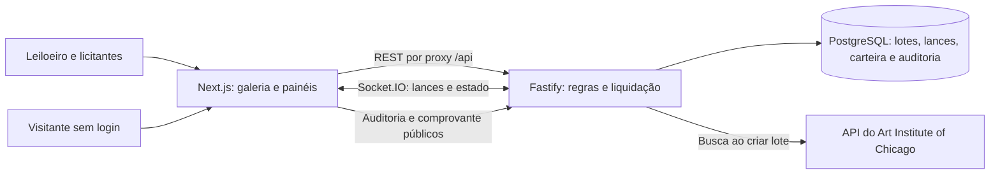

# LanceArte

Casa de leilões de obras de arte, criada para o teste técnico Elite Dev da Verzel. O projeto usa Next.js e TypeScript na interface, Fastify e Socket.IO na API, PostgreSQL para persistência e catálogos do Art Institute of Chicago, Projeto Portinari e LACMA para descobrir obras.

## Funcionalidades

- Vitrine de lotes agendados, ao vivo e encerrados.
- Painel de leiloeiro com busca de obras, criação e cancelamento de lotes sem lances.
- Sala de leilão com atualização em tempo real, lances pseudonimizados e prorrogação nos dois minutos finais.
- Carteira de demonstração com depósitos, saldo disponível e comprometido, reserva e liquidação do lance vencedor.
- Comprovante de arremate com link público e histórico público com verificação da cadeia SHA-256.
- Cadastro e login por e-mail, senha armazenada com hash e escolha de papel no cadastro.
- Tema claro e escuro, com preferência salva no navegador e respeito ao tema do sistema na primeira visita.
- Credenciais de teste para experimentar o acervo como licitante ou leiloeiro.

Todos os valores são simulados; não há pagamentos reais.

## Arquitetura



## Executar localmente

Requisitos: Node.js 22 ou superior, npm e Docker Desktop com Docker Compose.

1. Copie `.env.example` para `.env` na raiz do repositório. Os valores padrão funcionam para desenvolvimento local.
2. Instale os pacotes com `npm run install:all`.
3. Inicie o PostgreSQL com `docker compose up -d postgres`.
4. Crie o esquema e os dados de demonstração:

   ```bash
   npm run db:setup
   npm run db:seed
   ```

5. Inicie API e interface em dois terminais com `npm run dev:api` e `npm run dev:web`, ou juntos com `npm run dev`.
6. Abra `http://localhost:3000`.

Para executar a pilha inteira em containers, use `docker compose up --build`. O primeiro início da API aplica o esquema e cria os dados de demonstração. Para remover os dados locais e começar novamente, rode `docker compose down -v` e suba os serviços outra vez.

## Perfis e dados de demonstração

Em **Acessar o acervo**, entre com uma conta existente ou crie um perfil. O cadastro pergunta se a pessoa quer dar lances (licitante) ou oferecer obras (leiloeiro).

| Papel | E-mail | Senha |
| --- | --- | --- |
| Licitante | `colecionador@lancearte.test` | `Galeria#2026` |
| Leiloeira | `leiloeira@lancearte.test` | `Atelie#2026` |
| Segundo licitante para simular disputa em outra janela | `segundo.licitante@lancearte.test` | `Segundo#2026` |

O seed cria ou atualiza essas credenciais e preserva os lotes de demonstração ao ser executado novamente. Use os e-mails `.test` somente na demonstração.

## Configuração

| Variável | Uso |
| --- | --- |
| `DATABASE_URL` | URL de conexão do PostgreSQL |
| `SESSION_SECRET` | Segredo para assinar o cookie de sessão |
| `API_PORT` / `PORT` | Porta da API (o Render fornece `PORT`) |
| `WEB_ORIGIN` | Origem pública da interface permitida pelo CORS da API |
| `NEXT_PUBLIC_API_URL` | URL direta da API no desenvolvimento local; deixe vazia no deploy Vercel para usar o proxy `/api` |
| `NEXT_PUBLIC_SOCKET_URL` | URL da API para a conexão Socket.IO |
| `API_PROXY_TARGET` | Destino server-side do rewrite Next.js `/api/*` |
| `AIC_USER_AGENT` | Identificação da aplicação enviada à API do museu; em deploy público, inclua um endereço de contato seu |

Em desenvolvimento, a interface usa `http://localhost:4000` diretamente. No Vercel, configure `API_PROXY_TARGET` com a URL do serviço Render; as chamadas REST passam pelo rewrite `/api`, e `NEXT_PUBLIC_SOCKET_URL` aponta para a API para eventos em tempo real. Configure `WEB_ORIGIN` no Render com a URL exata do projeto Vercel. A sessão chega pelo proxy REST e usa cookie `HttpOnly`.

## API

- `GET /health`, `GET /auth/me`, `POST /auth/register`, `POST /auth/login`, `POST /auth/logout`
- `GET /images/:imageId` para servir imagens do IIIF do Art Institute com o cabeçalho de identificação esperado pela API externa
- `GET /items?q=...`, `GET /lots`, `GET /lots/:id`, `GET /lots/:id/bids`
- `POST /lots`, `POST /lots/:id/cancel`, `POST /lots/:id/bids`
- `GET /wallet/me`, `POST /wallet/deposits`, `GET /wallet/wins`
- `GET /audit/lots/:id`, `GET /receipts/:token`
- Socket.IO: o cliente entra na sala com `lot:join`; recebe `lot:bid` e `lot:closed`.

## Deploy

O repositório inclui `render.yaml` para publicar a API no Render. Crie o banco PostgreSQL no Neon e informe sua URL em `DATABASE_URL`; publique a API pelo blueprint e defina `WEB_ORIGIN` e `AIC_USER_AGENT`. No projeto Vercel, selecione `apps/web` como diretório raiz e configure:

- `API_PROXY_TARGET=https://<sua-api>.onrender.com`
- `NEXT_PUBLIC_SOCKET_URL=https://<sua-api>.onrender.com`

Depois do primeiro deploy, confirme que `/health` da API responde e que a URL da interface aparece em `WEB_ORIGIN`. A API aplica o esquema pelo comando `npm run db:setup` e cria usuários/lote demonstrativo com `npm run db:seed`; execute os dois com as variáveis configuradas antes de validar o fluxo público.

## Decisões e limites conhecidos

- Os catálogos externos são consultados ao pesquisar e criar lotes. O retrato do item fica salvo localmente; a vitrine e os lotes existentes não dependem de nova consulta aos museus.
- Senhas são verificadas com scrypt e nunca armazenadas em texto puro. Sessões usam cookie `HttpOnly`.
- A carteira, depósitos e liquidação servem apenas para demonstrar regras de negócio.
- Os eventos de auditoria são append-only no PostgreSQL e formam uma cadeia SHA-256 por lote. A página pública recalcula essa cadeia e detecta divergências nos registros apresentados.
- Cancelamento é permitido somente antes do primeiro lance; como lances em disputa não podem ser cancelados, não há estorno automático nesse fluxo. A vitrine oferece busca e filtros por estado do lote.

## Verificações automatizadas

Os testes de domínio cobrem lance inicial e incremento, saldo insuficiente, lance do líder/leiloeiro, encerramento, prorrogação e integridade da cadeia de auditoria. Para executá-los: `npm test`.
